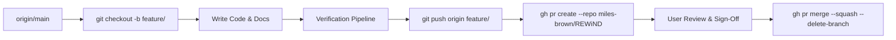
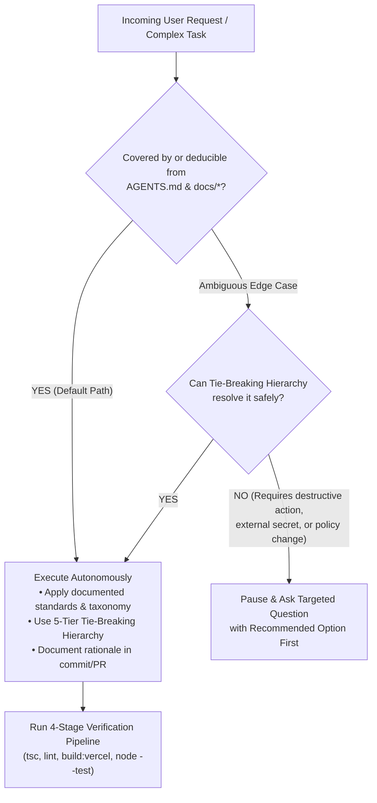

# AGENTS.md — Operational Protocol for AI Code Assistants

This document is the **highest-priority operational guideline** for AI coding assistants working in the **REWIND Evidence Atlas** codebase. Any AI agent operating in this repository MUST strictly follow these rules without exception.

---

## 1. Repository Identity, Remote Binding & Strict Workspace Isolation

- **Canonical Repository**: `https://github.com/miles-brown/REWiND.git`
- **Primary Git Remote**: `origin` (points strictly to `miles-brown/REWiND`)
- **NEVER** push, branch, or open PRs against any secondary or external repository.
- **STRICT REPOSITORY ISOLATION & ZERO EXTERNAL ACCESS (MANDATORY INVARIANT)**:
  - The **REWIND Evidence Atlas** is strictly isolated, independent, and self-contained.
  - Any AI assistant, agent, reviewer, or automated system operating in or on this repository is **STRICTLY PROHIBITED** from checking, opening, reading, executing, mentioning, involving, including, or referencing any other repository, project, or directory in the user's filesystem or GitHub folder (including, without limitation, `TS-Now` or any other sibling repository under `~/Github/`).
  - Operational scope is rigidly constrained to `/Users/milesbrown/Github/REWiND` (`~/Github/REWiND`).
  - Never inspect external files, never infer dependencies or features from other projects, and never cite or name any external repository in chat responses, code comments, commit messages, PR titles/descriptions, or documentation.

---

## 2. Mandatory Branch & Pull Request Workflow

**NEVER commit or push directly to `main`.** Every bugfix, feature, data update, or documentation addition must adhere to this exact lifecycle:



### Step-by-Step Procedure

1. **Branch**:
   ```bash
   git checkout main
   git pull origin main
   git checkout -b feature/<descriptive-feature-name>
   # Or directly: git fetch origin && git checkout -b feature/<descriptive-feature-name> origin/main
   ```

2. **Implement & Test**:
   - Write clean, strongly typed TypeScript / React 19 components.
   - Maintain documentation integrity.

3. **Mandatory Pre-PR Verification Pipeline** (all must exit with code `0`):
   ```bash
   # 1. Typecheck
   npx tsc --noEmit

   # 2. Linting (0 errors, 0 warnings)
   npm run lint

   # 3. Production Build
   npm run build:vercel

   # 4. Automated Tests
   node --test tests/*.test.mjs
   ```

4. **Commit**:
   - Use conventional commit messages: `feat(timeline): ...`, `fix(slider): ...`, `docs(api): ...`.

5. **Push & Open Pull Request**:
   ```bash
   git push origin feature/<descriptive-feature-name>
   gh pr create --repo miles-brown/REWiND --base main --head feature/<descriptive-feature-name> --title "..." --body "..."
   ```

6. **Trigger Automated AI Code Reviews**:
   - **Gemini AI Review Agent**: Automatically runs in GitHub Actions on every PR push (`.github/workflows/gemini-pr-review.yml`) or locally via `npm run review:gemini`.
   - **Codex AI Review**:
     ```bash
     gh pr comment <PR_NUMBER> --repo miles-brown/REWiND --body "@codex review"
     ```
   - **CodeRabbit AI Review** (On-Demand to preserve free quotas):
     ```bash
     gh pr comment <PR_NUMBER> --repo miles-brown/REWiND --body "@coderabbitai review"
     ```
   - Inspect and address all forensic findings raised by Gemini, Codex, CodeRabbit, or GitHub Copilot.

7. **Wait for User Review & Merge Sign-Off**:
   - Provide the PR URL and a clear walkthrough summary to the user.
   - Do **NOT** merge the PR until the user has reviewed and approved it.
   - Once approved, merge safely using `npm run pr:safe-merge <PR_NUMBER>` (or `gh pr merge --squash --delete-branch` after verifying zero open child PRs target the branch).

### Mandatory PR Branch Isolation & Anti-Cascade Invariants

To prevent work duplication, PR closing cascades, and merge regressions, all AI coding assistants and contributors must strictly enforce these 4 invariants:

1. **Rule 1: Single Canonical Base (`--base main`)**:
   - Every pull request MUST have its own isolated feature branch cut freshly from `origin/main` and MUST target `--base main`.
   - **NEVER** open PRs targeting another unmerged or ephemeral feature branch.

2. **Rule 2: Foundation-First Modular Delivery (Trunk-Based Micro-PRs)**:
   - Land foundational layers (PostgreSQL schemas, DB clients, core utilities, shared types) in self-contained micro-PRs into `main` first.
   - Subsequent consumer features or UI components branch off the updated `main`.

3. **Rule 3: Rebase Instead of Stack for Concurrent Features**:
   - If feature branches are developed concurrently, synchronize with newly merged `main` via `git fetch origin && git rebase origin/main`.
   - Never stack unmerged PR branches onto one another.

4. **Rule 4: Safe Deletion & Cascade Prevention**:
   - `--delete-branch` is strictly permitted only for merged branches targeting `main`.
   - If stacked or child branches are ever encountered, rebase each child branch onto `origin/main` (`git fetch origin && git rebase origin/main`) and retarget child PRs to `main` via `gh pr edit <PR> --base main` *before* deleting any parent branch.

---

## 3. Architecture & Data Integrity Standards

1. **Forensic Evidence Rigor**:
   - Every historical event added to `data/rewind.ts` or the database MUST have valid `sourceIds` referencing primary government/parliamentary transcripts, unedited broadcast audio/video, or contemporary news reports.
   - Never fabricate or guess dates, coordinates, or participant lists.

2. **Accessibility Standards (WCAG 2.1 AA)**:
   - Radix Slider thumbs must receive `aria-label`, `aria-valuetext`, `aria-valuenow`, `aria-valuemin`, and `aria-valuemax`.
   - All interactive controls must support keyboard navigation (`Tab`, `Space`, `Enter`, Arrow keys) with visible `:focus-visible` styling.
   - Dynamic timeline updates must announce state via `aria-live="polite"`.

3. **Viewport & UI Responsiveness**:
   - The timeline console (`PersonTimeline.tsx` / `RewindExplorer.tsx`) must remain fixed to the viewport bottom with zero-gap clamping and proper padding so content never bleeds or overlaps.

4. **Biographical Naming & Role Separation Invariant**:
   - Personal names (`canonicalName`, `displayName`) must contain only the individual's actual name (e.g. `Tenzin Gyatso`, `David Armstrong-Jones`).
   - Never embed official roles, tenures, or specific ordinals (e.g. `14th Dalai Lama`) into personal name fields. Official numbered roles belong strictly in the structured `roles` array (`roles-seed.ts`).
   - In `primaryRole` and extended summaries, use natural current/former relational descriptors (e.g. `Current Dalai Lama & Spiritual Leader of Tibetan Buddhism`).

---

## 4. Repository Directory Structure

```
├── app/                      # Next.js 16 App Router (Routes & Server Pages)
├── components/
│   ├── rewind/               # Domain-specific historical atlas components
│   └── ui/                   # Reusable accessible UI primitives (Radix / Tailwind)
├── data/                     # Historical dataset models & seed registers
├── db/                       # Drizzle ORM relational PostgreSQL schemas (schema.ts, schema-v2.ts)
├── docs/                     # Comprehensive documentation suite
│   ├── architecture/         # System architecture, design system, Event Model v2, map modes
│   │   ├── DESIGN_SYSTEM_AND_ALIGNMENT.md
│   │   ├── EVENT_MODEL_V2.md
│   │   ├── GEOSPATIAL_AND_MAP_MODES.md
│   │   ├── REPO_GROWTH_AND_ROADMAP.md
│   │   └── system-overview.md
│   ├── guides/               # Getting started, keyboard shortcuts
│   ├── policy/               # Autopublish, event inclusion, person eligibility, source policy
│   ├── standards/            # Taxonomy & system functions, biographical, location, temporal, evidence
│   │   ├── TAXONOMY_AND_SYSTEM_FUNCTIONS.md
│   │   ├── EVENT_AND_VENUE_STANDARD.md
│   │   ├── LOCATION_STANDARD.md
│   │   ├── TEMPORAL_STANDARD.md
│   │   ├── BIOGRAPHICAL_STANDARD.md
│   │   └── ...
│   ├── ACCESSIBILITY.md      # WCAG AA & ARIA contracts
│   ├── ARCHITECTURE.md       # System architecture & subsystem boundaries
│   ├── CONTRIBUTING.md       # Contribution guidelines
│   ├── DATA_SCHEMA.md        # TypeScript entity contracts
│   └── METHODOLOGY.md        # Forensic evidence tiers & verification scoring
├── lib/                      # Domain engines (rewind/, ingestion/, models/, adapters/, citations.ts)
├── scripts/                  # Build, environment, safe-merge & verification scripts
├── supabase/migrations/      # PostgreSQL SQL migrations & RLS policies
└── tests/                    # Automated Node.js unit & forensic verification tests
```

---

## 5. PostgreSQL Architecture Invariants & Forensic Ingestion Systematics

All code interacting with the Supabase / PostgreSQL data layer, ingestion pipeline, or downstream event rendering MUST adhere to these 5 core invariants:

1. **Default Evidentiary Confidence**:
   - The default confidence level for claims, event presence, and uncorroborated records must strictly be `"limited"`. Never default unverified claims or fallback records to `"confirmed"` or `"strong"`.

2. **Database-First Live Entity/Place Resolution & Ingestion Deduplication**:
   - The ingestion pipeline (`lib/ingestion/pipeline.ts`) must perform asynchronous duplicate detection (`findDuplicateEventAsync`) against live Supabase PostgreSQL tables before insertion.
   - For distinct historical events occurring on the same date with matching base slugs, generate deterministic collision suffixes (`evt-...-2`, `evt-...-3`) rather than overwriting or throwing errors.

3. **Row-Level Security (RLS) & Coordinate Visibility**:
   - Location coordinate records in `event_person_locations` must enforce `public_visibility = 'public-exact'` in RLS policies to prevent unintentional leakage of sensitive coordinates or timestamps.

4. **Fail-Closed Year & Query Validation**:
   - All query parameters (such as `year` in `lib/rewind/events.ts`) must be strictly validated with regex (e.g. `/^\d{4}$/`) with immediate fail-closed return (empty array or 400 error) before passing into PostgREST `.like` or `.eq` filters to prevent malformed queries or unbounded scans.

5. **Transactional Claim Synchronization & Relationship Integrity**:
   - Synchronize claims using `persistedClaimIds` to prevent duplicate claim creation across adapters and services.
   - Route figures in comparison views (`/relationship/[a]/[b]`) must guard against self-pairs (`slugA !== slugB`) and preserve authoritative references across navigation.

6. **Permanent Addition & Non-Deletion Rule (Strict Invariant)**:
   - Once an entity (Person, Event, Place/Venue, Source, Timeline Milestone, Career Role, or Bio Record) has been added to the REWiND Evidence Atlas, it must **NEVER be deleted**.
   - Data is strictly additive and progressive. Records must only be improved, extended, enriched, modified, or merged under strict audited conditions:
     - **True Duplication**: When two records represent the exact same historical event or entity, perform live database deduplication (`findDuplicateEventAsync`), merging all attached claims, quotes, and co-attendees without losing context.
     - **Sparse / Incomplete Records**: Records with minimal info must NEVER be deleted for lack of information; they must be queued for automated enrichment and populated with verified primary sources, coordinates, dates, and biographical roles.
     - **Erroneous / Disputed Data**: Correct factual details in place or mark status as `"disputed"` / `"limited"`, maintaining archival provenance audit logs rather than removing records.

7. **Multi-Source Vacuum Crawlers & Participant Completeness**:
   - Ingestion crawlers and vacuum scrapers continuously index primary/secondary sources across official transcripts, parliamentary records, unedited broadcast audio/video, gazettes, and press archives.
   - Every ingested event must be verified for participant completeness: no confirmed attendees or participants may be omitted.
   - Every participant attached to an event must distinguish their **official title/office** (`role`, e.g. *"President of the United States"*, *"London Borough of Lambeth Presiding Officer"*) from their **event capacity** (`association`, e.g. *"interviewee"*, *"host"*, *"moderator"*, *"participant"*, *"contestant"*, *"expert-contributor"*, *"attendee"*).

---

## 6. Authoritative Query & Task Resolution Router ("Where Everything Is Handled & What to Check")

Whenever an AI code assistant is asked to inspect, debug, extend, or design any part of the REWiND Evidence Atlas, it MUST consult this routing table to locate the authoritative specification, code module, and verification test suite:

| Domain / Query Topic | Authoritative Documentation to Check | Primary Code Modules & Entrypoints | Verification Test Suite(s) |
| :--- | :--- | :--- | :--- |
| **Visual Design, Color Contrast, Z-Index & Viewport Alignment** | [`docs/architecture/DESIGN_SYSTEM_AND_ALIGNMENT.md`](docs/architecture/DESIGN_SYSTEM_AND_ALIGNMENT.md)<br/>[`docs/ACCESSIBILITY.md`](docs/ACCESSIBILITY.md) | `app/globals.css`<br/>`components/rewind/Shell.tsx`<br/>`components/ui/*` | `tests/ui-components.test.mjs`<br/>`tests/ui-maps-and-sources.test.mjs` |
| **Master Taxonomies & System Functions Catalog** | [`docs/standards/TAXONOMY_AND_SYSTEM_FUNCTIONS.md`](docs/standards/TAXONOMY_AND_SYSTEM_FUNCTIONS.md)<br/>[`docs/DATA_SCHEMA.md`](docs/DATA_SCHEMA.md) | `lib/rewind/types.ts`<br/>`data/rewind.ts` | `tests/data-integrity.test.mjs` |
| **Geospatial Map, Contrails, 3D Flight Arcs & Telemetry HUD** | [`docs/architecture/GEOSPATIAL_AND_MAP_MODES.md`](docs/architecture/GEOSPATIAL_AND_MAP_MODES.md)<br/>[`docs/architecture/DESIGN_SYSTEM_AND_ALIGNMENT.md`](docs/architecture/DESIGN_SYSTEM_AND_ALIGNMENT.md) | `components/rewind/MapGraphic.tsx`<br/>`lib/rewind/travel.ts`<br/>`lib/rewind/routing.ts`<br/>`lib/rewind/transport.ts` | `tests/transit-routing-animations.test.mjs`<br/>`tests/travel-and-maps.test.mjs`<br/>`tests/map-resilience.test.mjs` |
| **Chronology Scrubber & Bidirectional REWIND Playback** | [`docs/ARCHITECTURE.md`](docs/ARCHITECTURE.md)<br/>[`docs/guides/keyboard-shortcuts.md`](docs/guides/keyboard-shortcuts.md) | `components/rewind/PersonTimeline.tsx`<br/>`components/rewind/RewindExplorer.tsx` | `tests/ui-maps-and-sources.test.mjs`<br/>`tests/travel-and-maps.test.mjs` |
| **Places, 4-Tier Gazetteer, Venues, Sub-Venues & Mobile Vessels** | [`docs/standards/EVENT_AND_VENUE_STANDARD.md`](docs/standards/EVENT_AND_VENUE_STANDARD.md)<br/>[`docs/standards/LOCATION_STANDARD.md`](docs/standards/LOCATION_STANDARD.md) | `lib/rewind/places.ts`<br/>`components/rewind/PlacesExplorer.tsx`<br/>`app/places/page.tsx`<br/>`app/place/[slug]/page.tsx` | `tests/remote-attendance-and-places-fix.test.mjs` |
| **Remote Attendance Localization & Participant Precedence** | [`docs/standards/EVENT_AND_VENUE_STANDARD.md`](docs/standards/EVENT_AND_VENUE_STANDARD.md)<br/>[`docs/architecture/EVENT_MODEL_V2.md`](docs/architecture/EVENT_MODEL_V2.md) | `lib/rewind/events.ts`<br/>`app/event/[slug]/page.tsx` | `tests/remote-attendance-and-places-fix.test.mjs` |
| **Biographical Naming, Roles, Milestones & Person Dossiers** | [`docs/standards/BIOGRAPHICAL_STANDARD.md`](docs/standards/BIOGRAPHICAL_STANDARD.md)<br/>[`docs/standards/PEOPLE_AND_INCLUSION_STANDARD.md`](docs/standards/PEOPLE_AND_INCLUSION_STANDARD.md)<br/>[`docs/policy/PERSON_ELIGIBILITY_POLICY.md`](docs/policy/PERSON_ELIGIBILITY_POLICY.md) | `data/people-master-seed.ts`<br/>`data/roles-seed.ts`<br/>`lib/rewind/people.ts`<br/>`app/person/[slug]/page.tsx`<br/>`components/rewind/PersonWorkspaceTabs.tsx` | `tests/person-bio-and-roles-coverage.test.mjs`<br/>`tests/people-directory-views-and-bio-audit.test.mjs` |
| **Temporal Precision, ISO-8601 Dates & Year Validation** | [`docs/standards/TEMPORAL_STANDARD.md`](docs/standards/TEMPORAL_STANDARD.md) | `lib/rewind/events.ts`<br/>`lib/rewind/format.ts` | `tests/temporal-evidence-standards.test.mjs` |
| **Evidentiary Confidence, Sources, Claims & Discrepancies** | [`docs/METHODOLOGY.md`](docs/METHODOLOGY.md)<br/>[`docs/standards/EVIDENCE_STANDARD.md`](docs/standards/EVIDENCE_STANDARD.md)<br/>[`docs/standards/FACT_AND_CLAIM_STANDARD.md`](docs/standards/FACT_AND_CLAIM_STANDARD.md)<br/>[`docs/standards/CORRECTIONS_AND_DISPUTES.md`](docs/standards/CORRECTIONS_AND_DISPUTES.md) | `components/rewind/DiscrepancyViewer.tsx`<br/>`app/sources/page.tsx`<br/>`app/source/[id]/page.tsx` | `tests/temporal-evidence-standards.test.mjs`<br/>`tests/ui-maps-and-sources.test.mjs` |
| **Event Model v2 & PostgreSQL / Supabase Architecture** | [`docs/architecture/EVENT_MODEL_V2.md`](docs/architecture/EVENT_MODEL_V2.md)<br/>[`docs/DATA_SCHEMA.md`](docs/DATA_SCHEMA.md) | `db/schema.ts`<br/>`db/schema-v2.ts`<br/>`lib/models/event-v2.ts`<br/>`lib/adapters/event-v2-adapter.ts`<br/>`supabase/migrations/*.sql` | `tests/event-model-v2.test.mjs`<br/>`tests/supabase-architecture.test.mjs` |
| **Automated Ingestion, Deduplication & Publication Lanes** | [`docs/policy/AUTOPUBLISH_POLICY.md`](docs/policy/AUTOPUBLISH_POLICY.md)<br/>[`docs/policy/EVENT_INCLUSION_POLICY.md`](docs/policy/EVENT_INCLUSION_POLICY.md)<br/>[`docs/standards/AI_RESEARCH_POLICY.md`](docs/standards/AI_RESEARCH_POLICY.md) | `lib/ingestion/pipeline.ts`<br/>`lib/ingestion/resolve.ts`<br/>`lib/ingestion/policy.ts`<br/>`app/admin/evidence/page.tsx` | `tests/evidence-ingestion-pipeline.test.mjs` |
| **Cross-Timeline Comparison & Relationship Encounters** | [`docs/standards/TAXONOMY_AND_SYSTEM_FUNCTIONS.md`](docs/standards/TAXONOMY_AND_SYSTEM_FUNCTIONS.md) | `components/rewind/TimelineComparison.tsx`<br/>`app/compare/page.tsx`<br/>`app/relationship/[a]/[b]/page.tsx` | `tests/ui-maps-and-sources.test.mjs` |
| **Citations, Print-to-PDF & OpenGraph Dossier Exports** | [`docs/ARCHITECTURE.md`](docs/ARCHITECTURE.md) | `lib/citations.ts`<br/>`components/rewind/CitationModal.tsx`<br/>`app/api/export/event/[slug]/pdf/route.ts`<br/>`app/api/export/person/[slug]/pdf/route.ts` | `tests/ui-components.test.mjs`<br/>`tests/data-integrity.test.mjs` |
| **Git Branch Isolation, Safe Merge & CI Verification** | [`AGENTS.md`](AGENTS.md)<br/>[`docs/CONTRIBUTING.md`](docs/CONTRIBUTING.md) | `scripts/verify-git-workflow.mjs`<br/>`scripts/safe-branch-merge.mjs`<br/>`scripts/gemini-pr-review.mjs` | `tests/git-workflow-and-branch-safety.test.mjs`<br/>`tests/docs-integrity.test.mjs` |

---

## 7. Autonomous Decision-Making & Escalation Protocol for Complex Tasks

When an AI code assistant encounters a complex, multi-layered, or underspecified task, it MUST NOT stall or ask the user to micromanage routine architectural or implementation choices. Instead, follow this three-tier decision protocol:



### 7.1 Rule of Precedent-Driven Autonomy (Default Operating Mode)
1. **Consult Documentation First**: Before making any design, schema, styling, or logic decision, check the relevant specification in Section 6 above (`docs/architecture/*`, `docs/standards/*`, `docs/policy/*`).
2. **Decide & Proceed Autonomously**: If the user's request leaves implementation details open, **make the decision autonomously** by aligning strictly with the architecture, taxonomy, and design standards already established in `docs/`. Do not interrupt the workflow for routine sequential steps or design decisions that have a documented precedent.
3. **Update Documentation When Introducing New Patterns**: Whenever a complex task introduces a new component, taxonomy value, database column, or UI convention, update the corresponding specification in `docs/` in the same PR so future agents inherit the exact decision.

### 7.2 Deterministic 5-Tier Tie-Breaking Hierarchy
Whenever two or more technical or design approaches appear viable for a complex problem, resolve the choice using this strict priority order (Tier 1 overrides Tier 2, Tier 2 overrides Tier 3, etc.):

1. **Tier 1 — Forensic Evidentiary Integrity & Non-Fabrication**:
   - Prefer the option that preserves primary-source traceability, defaults uncorroborated confidence to `"limited"`, avoids fabricating coordinates/dates, and upholds the Permanent Addition & Non-Deletion Rule.
2. **Tier 2 — Database, Query & Security Fail-Closed Safety**:
   - Prefer the option that validates inputs via strict regex/Zod schemas before database queries, enforces `public_visibility = 'public-exact'` in RLS, and performs live deduplication (`findDuplicateEventAsync`).
3. **Tier 3 — WCAG 2.1 AA Accessibility & Assistive Technology Clarity**:
   - Prefer the option that maintains $\ge 4.5:1$ contrast (no `#64748b` text on dark backgrounds), keeps 60fps DOM animations outside `aria-live` containers (using milestone-only status regions), and provides full keyboard + `:focus-visible` support.
4. **Tier 4 — Spatial Alignment & Viewport Non-Collision**:
   - Prefer the option that respects the 4-quadrant map allocation (`.map-stage-label` top-left, `.map-toolbar` top-right, `.map-transit-hud` bottom-left, `.map-floating-controls` bottom-right) and zero-gap bottom timeline console clamping (`PersonTimeline.tsx`, `RewindExplorer.tsx`).
5. **Tier 5 — React 19 Performance & Zero-Jank Rendering**:
   - Prefer `useRef` DOM updates for high-frequency (`requestAnimationFrame`) telemetry, `useMemo`/`useCallback` for derived datasets, and keeping collapsible state grids mounted (`hidden={!expanded}`) rather than unmounting and losing state.

### 7.3 Decomposition Strategy for Complex Multi-Subsystem Tasks
When executing a large or complicated task spanning multiple layers of the stack:
1. **Layer 1 (Schema & Types)**: Update `lib/rewind/types.ts`, `lib/models/event-v2.ts`, or `db/schema-v2.ts` first.
2. **Layer 2 (Domain & Ingestion Logic)**: Implement pure, testable functions in `lib/rewind/*` or `lib/ingestion/*` with fail-closed fallbacks.
3. **Layer 3 (UI Components & Styling)**: Wire into `components/rewind/*` and `app/globals.css` adhering to [`docs/architecture/DESIGN_SYSTEM_AND_ALIGNMENT.md`](docs/architecture/DESIGN_SYSTEM_AND_ALIGNMENT.md).
4. **Layer 4 (Verification & Regression Tests)**: Add deterministic assertions in `tests/*.test.mjs` and run all 4 pre-PR verification gates (`npx tsc --noEmit`, `npm run lint`, `npm run build:vercel`, `node --test tests/*.test.mjs`) until all exit with code `0`.


