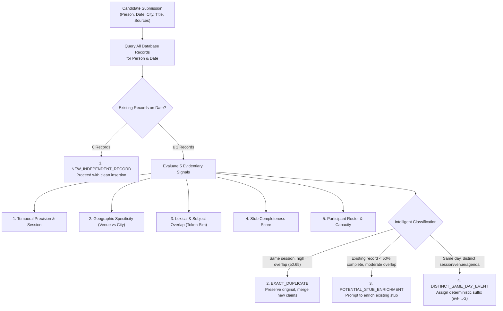

# Deduplication, Stub Resolution & Participant Capacity Standard

## Status & Purpose
This document specifies the authoritative operational protocol for verifying historical events and participant additions to the **REWIND Evidence Atlas**. It establishes a multi-signal verification engine that evaluates new information without assuming duplicate or non-duplicate status, detects incomplete stubs, and enforces clear separation between constitutional office (`role`) and event capacity (`association`).

---

## 1. Core Evidentiary Problem: Why Simple Deduplication Fails

In forensic historical chronology, a binary deduplication check (e.g. matching on date and city) produces two critical classes of error:
1. **False Merges of Distinct Same-Day Appearances**: Prominent figures frequently participate in multiple distinct events on a single calendar day (e.g. a morning bilateral meeting at 10:00 AM, an afternoon press conference at 2:00 PM, an evening state banquet at 8:00 PM, and departure transit). Collapsing these into one record erases critical historical milestones.
2. **Duplication of Existing Incomplete Stubs**: When a preliminary or uncorroborated stub exists for an event (e.g. placeholder summary, unlinked venue, zero primary sources), naive ingestion often creates a second parallel record rather than enriching the existing record.

---

## 2. The 4-Tier Non-Assuming Verification Classification

Whenever candidate information is submitted (via manual entry or automated crawler), the engine evaluates it across 5 distinct evidentiary signals, classifying it into one of 4 deterministic outcomes:

### Classification Specifications

| Outcome | Trigger Conditions | Engine Recommendation |
| :--- | :--- | :--- |
| **`EXACT_DUPLICATE`** | Same date, matching municipality/theatre, overlapping participants, title/summary similarity $\ge 0.65$, and no conflicting timestamps. | **Do not insert duplicate**. Offer to append new corroborating citations, quotes, and claims to the existing record. |
| **`POTENTIAL_STUB_ENRICHMENT`** | Same date and matching participant, existing record has stub completeness score $< 0.50$ (e.g. missing detailed summary, unlinked venue), and text similarity $\ge 0.20$. | **Enrich existing stub**. Populate missing primary sources, exact coordinates, and participant capacities into the existing record. |
| **`DISTINCT_SAME_DAY_EVENT`** | Target person present on same date, but evidence demonstrates distinct times (e.g. 10:00 vs 20:00), distinct venues within city (e.g. Oval Office vs. Andrews AFB), or distinct agendas (speech vs. bilateral talks). | **Create distinct milestone**. Generate a deterministic collision-safe suffix (`evt-...-2`, `evt-...-3`) and link both to the person's dossier. |
| **`NEW_INDEPENDENT_RECORD`** | Zero records for this person on this calendar date. | **Clean insertion**. |

---

## 3. Stub Completeness Scoring Heuristic

An existing record is evaluated for completeness using a 4-pillar index:

$$\text{Completeness Score} = S_{\text{summary}} + S_{\text{venue}} + S_{\text{sources}} + S_{\text{roster}}$$

1. **Summary Quality ($S_{\text{summary}}$, Max 0.25)**:
   - $\ge 80$ characters of descriptive narrative: $+0.25$
   - $20\text{--}79$ characters: $+0.15$
   - $< 20$ characters or placeholder: $+0.00$
2. **Venue & Address Precision ($S_{\text{venue}}$, Max 0.25)**:
   - Specific named venue with physical coordinates: $+0.25$
   - Unspecified city-level only: $+0.00$
3. **Primary Source Corroboration ($S_{\text{sources}}$, Max 0.25)**:
   - $\ge 1$ verified archival source ID attached: $+0.25$
   - Zero sources attached: $+0.00$
4. **Participant Roster ($S_{\text{roster}}$, Max 0.25)**:
   - $\ge 2$ participants with distinct capacities documented: $+0.25$
   - 1 participant documented: $+0.15$
   - Empty roster: $+0.00$

> **Threshold**: Any record with $\text{Completeness Score} < 0.50$ is flagged as a **`potential-stub`**.

---

## 4. Participant Capacity vs. Official Role Questionnaire

Whenever a person is attached to an event, the system strictly separates their public office from their event capacity:

### A. Official Title / Office (`role`)
The figure's constitutional, diplomatic, or institutional title at the historical moment of the event:
- *"President of the United States"*
- *"UK Foreign Secretary"*
- *"Archbishop of Canterbury"*
- *"Chief Executive Officer, Microsoft"*

### B. Event Participation Capacity (`association`)
Selected strictly from [`STANDARD_CAPACITIES`](../../lib/rewind/types.ts):
- **Media & Broadcast**: `Host / Anchor`, `Co-Host`, `Interviewee`, `Correspondent / Reporter`, `Panelist / Commentator`, `Moderator`, `Keynote Speaker`, `Special Contributor`.
- **Diplomatic & State**: `Head of State`, `Head of Government`, `Foreign Minister`, `Special Envoy / Diplomat`, `Ambassador`, `Chief Negotiator`, `Treaty Signatory`, `Official Delegate`.
- **Legal & Official**: `Presiding Judge`, `Prosecutor / Counsel`, `Defense Counsel`, `Testifying Witness`, `Deponent`, `Investigator / Inspector`.
- **Civil & Organizational**: `Organizer / Convener`, `Chairperson`, `Executive / Director`, `Observer / Attendant`.

### C. Attendance Mode & Remote Geolocation
- `physical`: Present in person at the venue.
- `remote-video` / `remote-audio` / `telephone` / `remote-recorded` / `written-statement`: Remote appearance.
- **Mandatory Remote Localization**: All remote participants must record their **Origin City**, **Origin Country**, **Specific Remote Studio/Venue**, and **Connection Medium** (`satellite-feed`, `fiber-optic`, `isdn-audio`).

